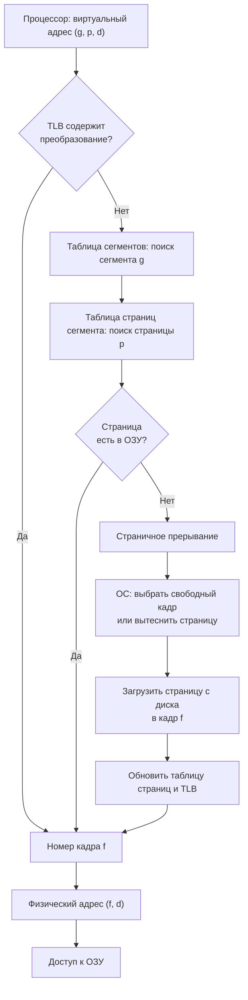

# Домашняя работа: виртуальная память

## Цель виртуальной памяти

Виртуальная память даёт каждому процессу собственное непрерывное адресное пространство, размер которого может быть больше доступной оперативной памяти. Программа обращается к виртуальным адресам, а процессор совместно с ОС преобразует их в физические адреса ОЗУ. Страницы, которые сейчас не нужны, хранятся во внешней памяти, обычно в файле подкачки или swap-разделе.

Такой подход изолирует процессы друг от друга, упрощает размещение программ в памяти и позволяет эффективно использовать ограниченный объём ОЗУ.

## Базовые понятия

- **Виртуальный адрес** — адрес, сформированный программой. В странично-сегментной модели он состоит из номера сегмента, номера страницы в сегменте и смещения внутри страницы.
- **Физический адрес** — реальный адрес ячейки ОЗУ.
- **Сегмент** — логическая часть адресного пространства: например, код программы, данные или стек. Сегменты имеют переменный размер.
- **Страница** — блок фиксированного размера. Виртуальная и физическая память делятся на страницы одинакового размера.
- **Кадр (frame)** — физическая страница ОЗУ, в которую ОС загружает виртуальную страницу.
- **Таблица сегментов** — содержит сведения о сегментах: наличие, права доступа и адрес таблицы страниц данного сегмента.
- **Таблица страниц** — для каждой виртуальной страницы хранит номер кадра ОЗУ либо признак того, что страница находится на диске.
- **TLB** — быстрый кэш последних преобразований виртуальных адресов. Попадание в TLB ускоряет обращение к памяти.

## Странично-сегментная организация

В этой архитектуре адресное пространство процесса сначала делится на сегменты, затем каждый сегмент разбивается на страницы. Такой вариант сочетает логическую структуру сегментов с удобством страниц фиксированного размера.

Виртуальный адрес имеет вид:

```text
┌──────────────┬──────────────┬──────────────────┐
│ № сегмента g │ № страницы p │ смещение d       │
└──────────────┴──────────────┴──────────────────┘
```

1. Процессор формирует виртуальный адрес `(g, p, d)`.
2. MMU проверяет TLB. Если там есть подходящая запись, она сразу даёт номер физического кадра.
3. При промахе TLB MMU по номеру `g` находит запись в таблице сегментов и адрес таблицы страниц.
4. По номеру `p` MMU ищет запись в таблице страниц. Если страница присутствует в ОЗУ, запись содержит номер кадра `f`.
5. Физический адрес образуется как `(f, d)`: смещение не изменяется, меняется только номер страницы.
6. Если страницы в ОЗУ нет, процессор генерирует страничное прерывание. ОС загружает страницу с диска, при необходимости освобождает кадр, обновляет таблицы и повторяет инструкцию.

## Схема работы



## Страничное прерывание и замещение

Страничное прерывание возникает, когда нужной странице соответствует запись «не присутствует» в таблице страниц. ОС должна найти место в ОЗУ. Если свободных кадров нет, она выбирает страницу-жертву.

Распространённые алгоритмы замещения:

- **FIFO** — вытесняется страница, которая дольше всех находится в памяти.
- **LRU** — вытесняется страница, к которой дольше всего не обращались.
- **LFU** — вытесняется страница с наименьшим числом обращений.
- **NUR/NRU** — выбор основан на битах обращения и модификации.
- **Случайный** — выбирается случайный кадр; прост в реализации, но не всегда эффективен.

Если вытесняемая страница изменялась, ОС предварительно записывает её на диск. Затем загружается требуемая страница, таблица страниц обновляется, и выполнение прерванной команды продолжается.

## Стратегии управления памятью

**Стратегия выборки** отвечает на вопрос, когда загружать страницу. При подкачке по требованию ОС загружает страницу только после обращения к ней. При упреждающей подкачке ОС пытается загрузить страницы заранее, используя локальность обращений.

**Стратегия размещения** определяет, в какой свободный кадр поместить страницу. Для страниц фиксированного размера проблема внешней фрагментации ОЗУ практически устраняется.

**Стратегия замещения** определяет, какую страницу удалить при нехватке кадров. Её задача — уменьшить число дорогостоящих обращений к диску.

## Достоинства и ограничения

Преимущества виртуальной памяти:

- программа может быть больше объёма доступной ОЗУ;
- каждый процесс получает изолированное адресное пространство;
- страницы размещаются в любых свободных кадрах;
- защита памяти реализуется через права сегментов и страниц.

Ограничения:

- промах страницы требует обращения к диску и значительно замедляет выполнение;
- таблицы сегментов и страниц занимают память;
- при недостатке ОЗУ возможен thrashing: система почти всё время меняет страницы вместо выполнения полезной работы;
- сегменты переменного размера могут вызывать фрагментацию на логическом уровне.

## Итог

Странично-сегментная виртуальная память преобразует виртуальный адрес `(g, p, d)` в физический адрес `(f, d)`. Сегмент задаёт логическую часть программы, страница задаёт блок фиксированного размера, а MMU и ОС обеспечивают преобразование адресов, загрузку отсутствующих страниц и защиту доступа.